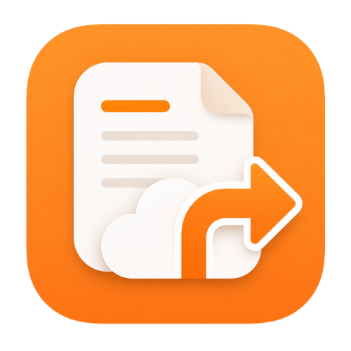

<h1 align="center">
  
</h1>

<h3 align="center">Mi Notes Exporter</h3>

<p align="center">
  Languages:
  <a href="../README.md">简体中文</a> ·
  <a href="./README_en.md">English</a>
</p>

---

A Chrome browser extension for batch exporting Xiaomi Cloud notes. Supports exporting to Markdown format, automatic image downloading, folder selection, and pause/resume functionality.

## ✨ Features

- ✅ **Batch Export**: Export notes from multiple folders at once
- ✅ **Markdown Format**: Export to standard Markdown format, compatible with Obsidian and other note-taking apps
- ✅ **Auto Image Download**: Automatically detect and download images from notes to local storage
- ✅ **Folder Selection**: Selectively export notes from specific folders
- ✅ **Pause/Resume**: Support pausing and resuming during export
- ✅ **Smart Anti-Crawl**: Configurable delays and batch processing to avoid anti-crawl detection
- ✅ **Real-time Progress**: Display export progress and logs in real time
- ✅ **Auto Year Completion**: Automatically fill in the full year for notes created in the current year
- ✅ **Native Side Panel**: Uses Chrome's native side panel for a cleaner UI

## 📦 Installation

### 1. Download the Project

Clone or download this repository:

```bash
git clone https://github.com/Horizen5/mi-notes-exporter.git
```

Or download the ZIP and extract it.

### 2. Install to Chrome

1. Open Chrome and navigate to `chrome://extensions/`
2. Enable the **Developer mode** toggle in the top-right corner
3. Click the **Load unpacked** button
4. Select the downloaded project folder
5. Confirm installation — you should see "Mi Notes Exporter" in the extension list

### 3. Browser Compatibility

This extension supports all Chromium-based browsers:

- Chrome 90+
- Edge 90+
- Brave
- Opera
- Vivaldi

## 🚀 Usage

### 1. Log in to Xiaomi Cloud

1. Visit [Xiaomi Cloud - Notes](https://i.mi.com/note/h5)
2. Log in with your Xiaomi account
3. Make sure you can see your notes list

### 2. Open the Extension Side Panel

1. Click the extension icon in the browser toolbar
2. Or click the "Mi Notes Exporter" icon on the right side of the address bar
3. The side panel will open automatically

### 3. Configure Export Options

#### Folder Selection

- Click "Refresh Folder List" to fetch all current folders
- Check the folders you want to export
- Supports "Select All / Deselect All"

#### Export Settings

- **Export Type**:
  - Full export (with images): Export note content and download all images
  - Text-only export: Export text content only, no image downloads
- **Image Folder Name**: Set the folder name for saving images (default: `images`)

#### Anti-Crawl Settings (recommended to keep defaults)

- **Min Delay**: Minimum wait time between operations (ms), default 1000ms
- **Max Delay**: Maximum wait time between operations (ms), default 3000ms
- **Batch Size**: Number of notes to process before a forced break, default 30
- **Batch Rest**: Forced break duration (ms), default 15000ms

### 4. Start Exporting

1. After confirming all settings, click the "Start Export" button
2. The extension will automatically:
   - Open each selected folder one by one
   - Extract note content one by one
   - Download images from notes
   - Save as Markdown and JSON files
3. During export, you can:
   - Click "Pause" to pause the export
   - Click "Resume" to continue the export
   - Click "Stop" to end the export (processed notes will be saved)

### 5. View Export Results

Exported files are automatically saved to the browser's default download directory:

```
Downloads/
├── Folder1.md                # Markdown format note file
├── Folder2.md
├── mi_note_Folder1.json      # Raw JSON data
├── mi_note_Folder2.json
└── images/                   # Image folder
    ├── Folder_YYMMDD_NoteID_1.jpg
    ├── Folder_YYMMDD_NoteID_2.jpg
    └── ...
```

## 📄 Export File Details

### Markdown File Structure

Each folder generates an independent Markdown file with the following format:

```markdown
# Mi Notes Export - Folder Name

Export Time: 2026-05-08 14:30:00
Note Count: 15

> Please place downloaded images in the images folder

---

## Note Title 1

> Created: March 15, 2026

Note content...


---

## Note Title 2

> Created: March 16, 2026

Note content...

---
```

### Image Naming Convention

Image file naming format: `FolderName_YYMMDD_Last4DigitsOfNoteID_Sequence.jpg`

Example: `Work_260315_ABCD_1.jpg`

## ❓ FAQ

### Q: The page freezes during export. What should I do?

**A:** Try the following:

1. Keep the Xiaomi Cloud page in the foreground
2. Do not minimize the browser window
3. Increase the delay settings appropriately
4. If frozen for more than 30 seconds, try pausing and resuming

### Q: Some images failed to download. What should I do?

**A:** Common reasons for image download failures:

1. Unstable network — check your internet connection
2. Image has been deleted — the image in the note may no longer exist
3. Xiaomi Cloud restrictions — try increasing the delay time
4. Login session expired — re-login to Xiaomi Cloud

### Q: How to avoid anti-crawl detection?

**A:** Recommended configuration:

- Increase min/max delay times
- Reduce batch size
- Increase batch rest time
- Avoid exporting multiple times in a short period

### Q: Can I resume after an interrupted export?

**A:** The current version starts fresh each time and does not support resuming. However, you can:

1. Keep track of which folders have been exported
2. Only select unexported folders next time
3. Or re-export (will overwrite files with the same name)

### Q: Why do some notes have no title?

**A:** Some notes in Xiaomi Notes may not have a title set. They will be displayed as "Untitled" when exported.

### Q: Can I use this in other browsers?

**A:** Yes! All Chromium-based browsers (Edge, Brave, Opera, etc.) are supported. The installation method is the same.

## ⚙️ Configuration Recommendations

### Conservative Configuration (Recommended)

```
Min Delay: 1500ms
Max Delay: 3000ms
Batch Size: 20
Batch Rest: 20000ms
```

### Fast Configuration (Risky)

```
Min Delay: 500ms
Max Delay: 1000ms
Batch Size: 50
Batch Rest: 10000ms
```

> Note: Fast configuration may result in being rate-limited by Xiaomi Cloud. Use with caution.

## 🔧 Technical Details

### Extension Architecture

- **Manifest V3**: Uses the latest Chrome extension specification
- **Content Script**: Runs within the Xiaomi Cloud page, responsible for scraping notes
- **Background Service Worker**: Handles file downloads and other background tasks
- **Side Panel**: Uses Chrome's native side panel for the user interface

### Data Security

- All data processing happens locally in the browser
- No data is uploaded to any third-party servers
- Only requires access to Xiaomi Cloud (i.mi.com)
- Uses Chrome Storage API to save configuration and progress

### File Name Filtering

Automatically filters special characters in file names:

- `[ ] 【 】 ( ) （ ）` and other brackets/spaces are removed
- `\ / : * ? " < > |` and other illegal characters are replaced with `_`

## 📋 Changelog

### v1.9.4

- Improved note extraction stability
- Enhanced image download mechanism
- Added sweep-back feature to reduce missed notes
- Optimized collision detection algorithm
- Improved login session persistence

### v1.0.0

- Initial release
- Basic note export functionality
- Image download support
- Folder selection
- Anti-crawl settings

## 📧 Feedback & Support

If you encounter issues or have suggestions:

- Report on [GitHub Issues](https://github.com/Horizen5/mi-notes-exporter/issues)
- Check the browser console (F12) for error messages
- Review the extension side panel log output

## 🔒 Privacy Policy

- This extension runs entirely locally and does not upload any data
- All note data is saved only to your local download folder
- No user information or usage statistics are collected
- Only accesses Xiaomi Cloud (i.mi.com) to retrieve your notes

## ⚠️ Disclaimer

This tool is intended solely for personal backup of your own Xiaomi Cloud notes. Do not use it for commercial purposes or to infringe on others' privacy. Users bear full responsibility for any consequences of using this tool.

## 📄 License

MIT License

> **Tip**: Please ensure you have backed up important data before use!

⭐ If you find this tool helpful, please give it a Star!
